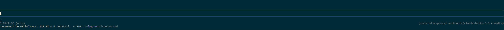

# pi-openrouter-balance

A [pi](https://github.com/earendil-works/pi-coding-agent) extension that shows your **OpenRouter credit balance** in the footer, right below the input line.



```
caveman:lite OR balance: $22.57 ○ ponytail: ⚡ FULL telegram disconnected
```

## Features

- Shows `OR balance: $X.XX` in the pi footer.
- Refreshes on session start, after each agent turn settles, and every 5 minutes.
- Manual refresh with `/or-balance`.
- Shows `OR balance: n/a` and a warning notification if the request fails.
- No API key is stored in the extension. It is read from your existing pi config.

## Requirements

- pi coding agent with extension support.
- An OpenRouter API key.
- A provider named `openrouter-proxy` in `~/.pi/agent/models.json`:

```json
{
  "providers": {
    "openrouter-proxy": {
      "baseUrl": "https://openrouter.ai/api/v1",
      "apiKey": "sk-or-v1-..."
    }
  }
}
```

The extension calls `GET {baseUrl}/credits` with `Authorization: Bearer <apiKey>` and computes:

```
balance = total_credits - total_usage
```

## Installation

Copy the extension into pi's extensions directory:

```bash
# Windows (Git Bash)
cp openrouter-balance.ts ~/.pi/agent/extensions/

# Linux / macOS
cp openrouter-balance.ts ~/.pi/agent/extensions/
```

Then restart pi, or run `/reload` if your version supports it.

## Usage

| Action | How |
|---|---|
| See balance | Look at the footer after session start |
| Refresh now | `/or-balance` |
| Stop polling | Automatic on session shutdown |

## Troubleshooting

| Symptom | Cause |
|---|---|
| `OR balance: n/a` + warning `provider "openrouter-proxy" not found` | Missing provider block in `models.json` |
| `OR balance: n/a` + warning `HTTP 401` | Invalid or revoked API key |
| `OR balance: n/a` + warning `HTTP 403` | Key without access to the `/credits` endpoint (use a regular key, not a restricted one) |

## License

MIT
